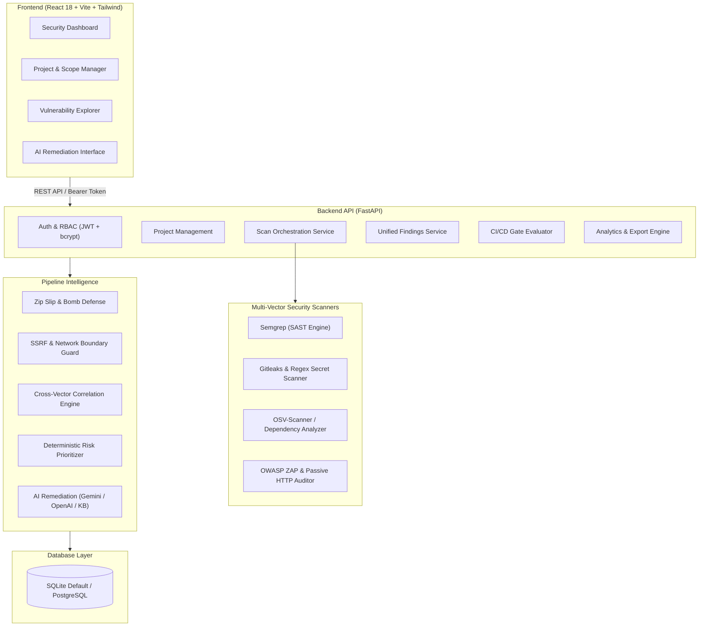

# Platform Architecture & Design

The **AI-Powered Application Security Testing and DevSecOps Platform** provides an integrated vulnerability management and automated policy enforcement pipeline.

---

## Architecture Components

### 1. Presentation Layer (Frontend)
- **Framework**: React 18 with TypeScript 5 and Vite 5.
- **Styling**: Tailwind CSS with custom security badge palettes and dark mode base styling.
- **Visualization**: Recharts for severity distribution (Pie charts) and security vectors (Bar charts).
- **Navigation**: React Router DOM with guarded authentication flows and unified dashboard layout.

### 2. Service & API Layer (Backend)
- **Framework**: FastAPI (asynchronous ASGI).
- **Authentication**: JWT tokens (HS256) with native `bcrypt` password hashing and role-based permissions (`admin`, `security_engineer`, `developer`, `viewer`).
- **Validation**: Pydantic v2 type enforcement with custom field sanitizers.
- **Database Engine**: SQLAlchemy 2.0 with async engine (`aiosqlite`) for development and PostgreSQL support for production.

### 3. Pipeline Intelligence & Security Guards
- **SafeArchiveService**: Prevents Zip Slip, directory traversal, archive bombs, and symlink attacks during source code upload. Never executes untrusted code.
- **TargetValidator**: Enforces SSRF defenses before launching DAST; blocks loopback, RFC 1918 private subnets, and cloud metadata (169.254.169.254).
- **CorrelationEngine**: Discovers relationships between static source findings and dynamic runtime findings (e.g. SAST parameter vulnerability linking to DAST runtime endpoint alert).
- **RiskPrioritizer**: Calculates a normalized 0.1–10.0 risk score combining severity, confidence, exposure vector, and CVE metadata.
- **AIRemediationService**: Generates plain-English root cause analysis, potential impact, safe diff examples, and verification steps using deterministic templates or configured LLM APIs.
- **SecurityGateEvaluator**: Evaluates scan results against configurable project policies and provides deterministic pass/fail decisions for CI/CD gates.
